<div align="center">
  

  <h1>Auralink</h1>

  <p><strong>Every passenger, understood.</strong></p>
  <p>Repair-first communication between airline passengers and cabin crew, across accents, languages and a loud cabin.<br />
  When speech is unclear, Auralink <strong>asks the passenger one simple question</strong> instead of guessing.<br />
  A guided onboarding assistant welcomes every passenger in their own language, and one shared scanner replaces a
  QR code per seat.</p>

  <p>
    <a href="https://github.com/goyalnishtha841/auralink/actions/workflows/tests.yml"></a>
    <a href="LICENSE"></a>
    
    
    
  </p>

  <br />
  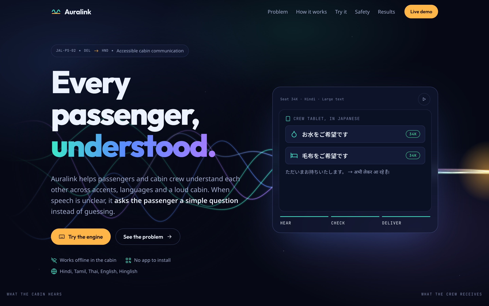
</div>

## The 30-second version

A passenger in seat 33H, flying Delhi → Tokyo, says *"Madam, thoda wotter and kambal please"*
(Hindi-English: "a little water and a blanket"). A Japanese crew member hears noise.

| | What happens |
|---|---|
| 🎙️ **Hear** | Whisper turns speech into several guesses in English **and** Hindi, all on the laptop. |
| 🧩 **Understand** | Filler words (*madam, thoda, please*) are dropped. *"wotter"* is matched to **water** by how it *sounds*, using an accent-aware phoneme distance, and *"kambal"* to **blanket**. One sentence becomes two requests. |
| ✅ **Check** | Unsure? The passenger's phone asks *"क्या आपका मतलब यह था? पानी"* ("Did you mean: water?") with a picture. One tap. |
| 📋 **Deliver** | The crew tablet shows **お水をご希望です · 33H** in Japanese. The crew taps a pre-approved reply, and the passenger reads it in Hindi. |

Nothing leaves the aircraft. There is no cloud speech service, no machine translation and no LLM.
Every sentence a passenger or crew member reads comes from a reviewed template.

## Take a look

<table>
  <tr>
    <td width="32%" valign="top">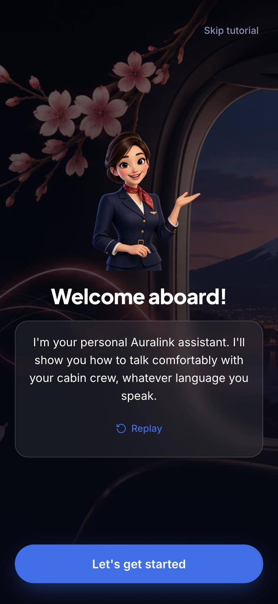<br /><sub><b>Onboarding assistant.</b> Every first-time passenger gets a short, skippable tour from an illustrated crew avatar, before anything else.</sub></td>
    <td width="32%" valign="top">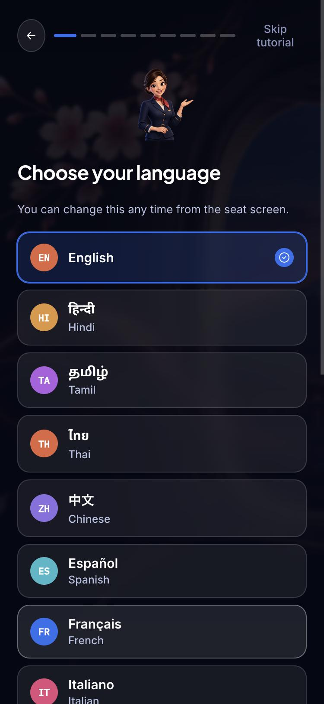<br /><sub><b>16 languages.</b> Every onboarding screen, request and crew reply is fully translated, not just the ones Auralink can speak aloud.</sub></td>
    <td width="32%" valign="top">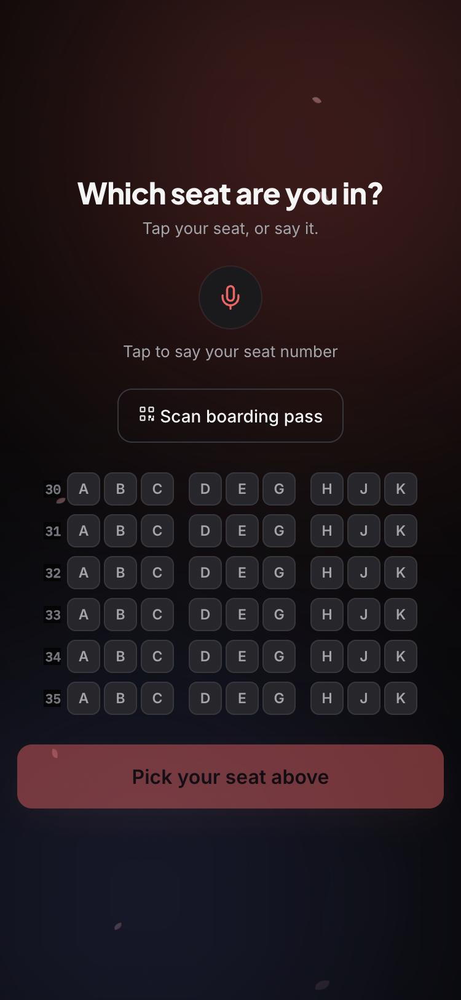<br /><sub><b>One shared scanner.</b> No screen at every seat? One QR code for the whole cabin: tap a seat, say it, or scan a boarding pass.</sub></td>
  </tr>
  <tr>
    <td width="32%" valign="top">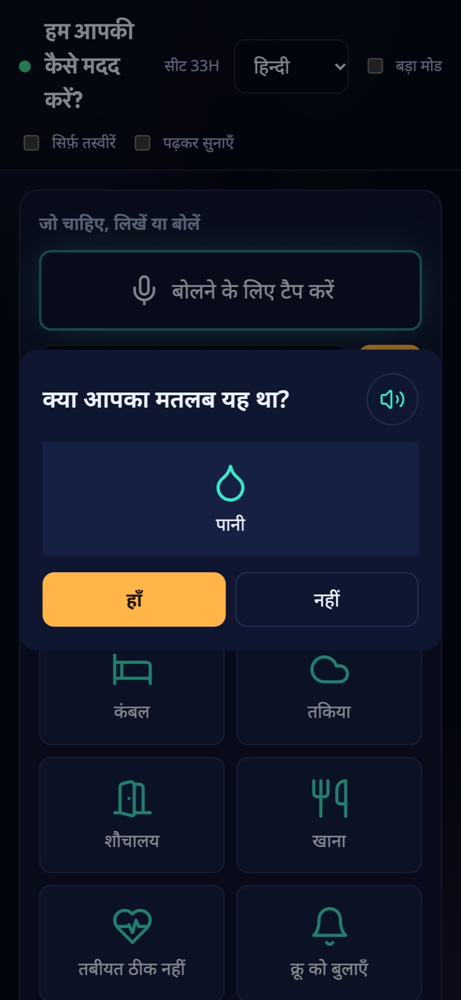<br /><sub><b>Passenger phone.</b> Asks instead of guessing, in the passenger's language, with pictures.</sub></td>
    <td width="32%" valign="top">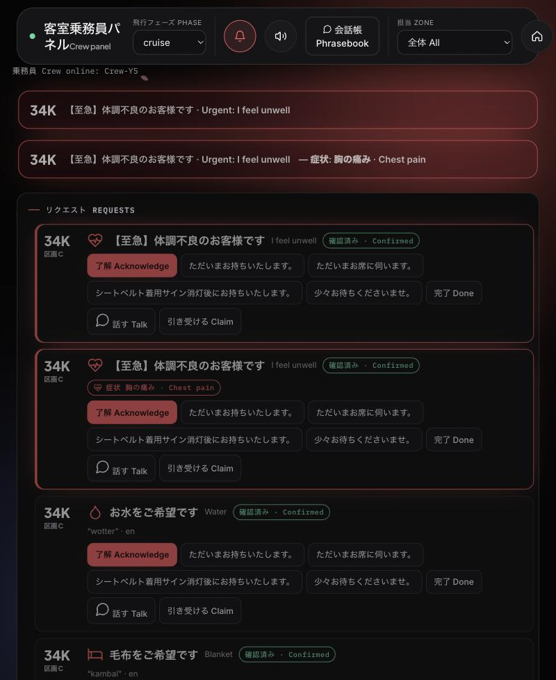<br /><sub><b>Crew tablet, in Japanese.</b> Urgent requests jump the queue before the passenger has even confirmed.</sub></td>
    <td width="32%" valign="top">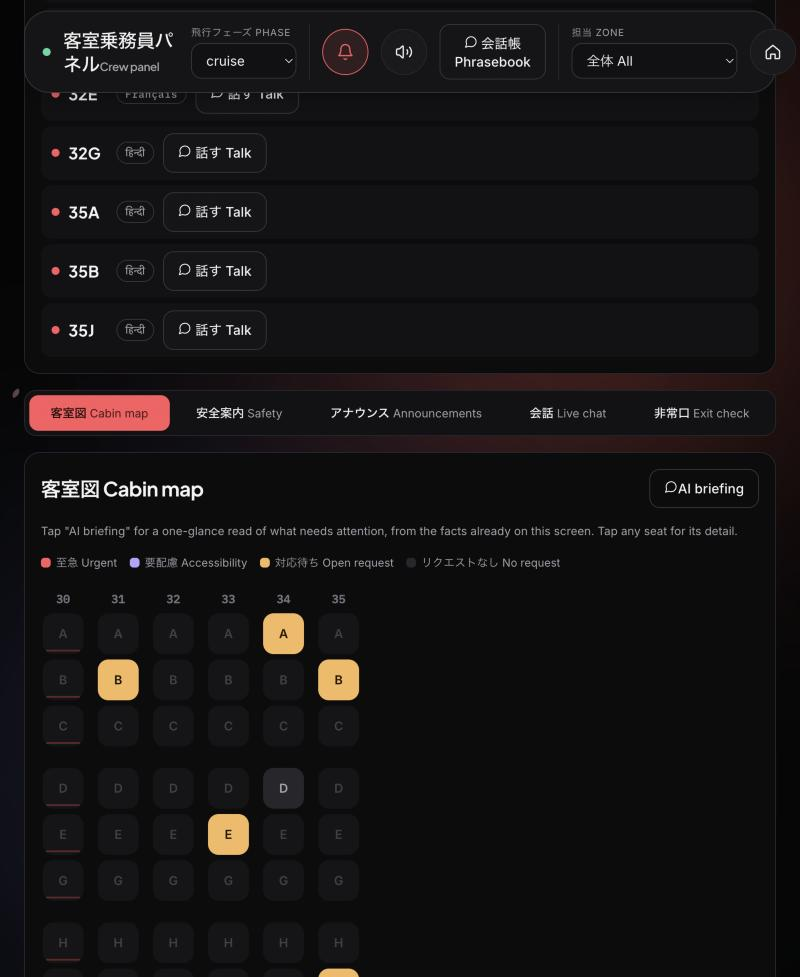<br /><sub><b>Cabin map, at a glance.</b> A seat with an accessibility profile on file is shown in violet, distinct from a plain open request.</sub></td>
  </tr>
  <tr>
    <td colspan="3">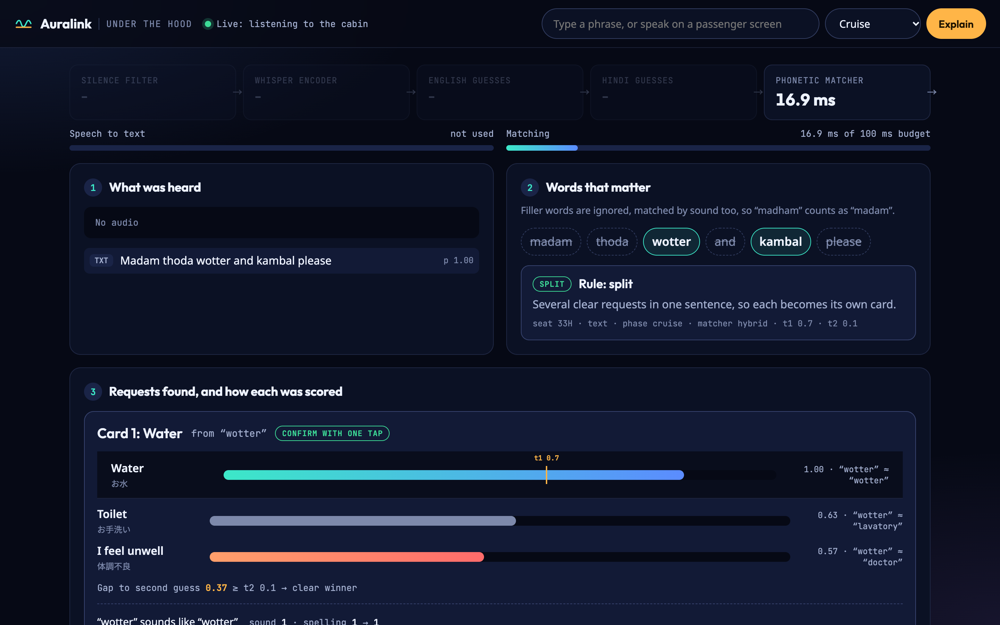<br /><sub><b>Under the hood (the jury screen).</b> Every decision in the open: which words mattered, which rule fired, and how each request was scored against the thresholds.</sub></td>
  </tr>
</table>

<p align="center"><a href="https://auralink-o11a.onrender.com/start"><strong>▶ Live demo</strong></a> -- open <code>/start</code> for the three-step walkthrough, passenger and crew PIN<br />
<sub>Render's free tier sleeps after inactivity, so the first open can take up to a minute, and Free Talk's translation/voice is dropped (see <a href="#deploying-a-live-demo">deploying a live demo</a>).</sub></p>

## Contents

- [How it works](#how-it-works) · [Results](#results) · [Features](#features)
- [Run it](#run-it) · [On phones](#on-phones) · [Testing and CI](#testing-and-ci)
- [Feature guide](#feature-guide) · [Deploying a live demo](#deploying-a-live-demo)
- [For developers](#for-developers) · [Evaluation](#evaluation)

## How it works

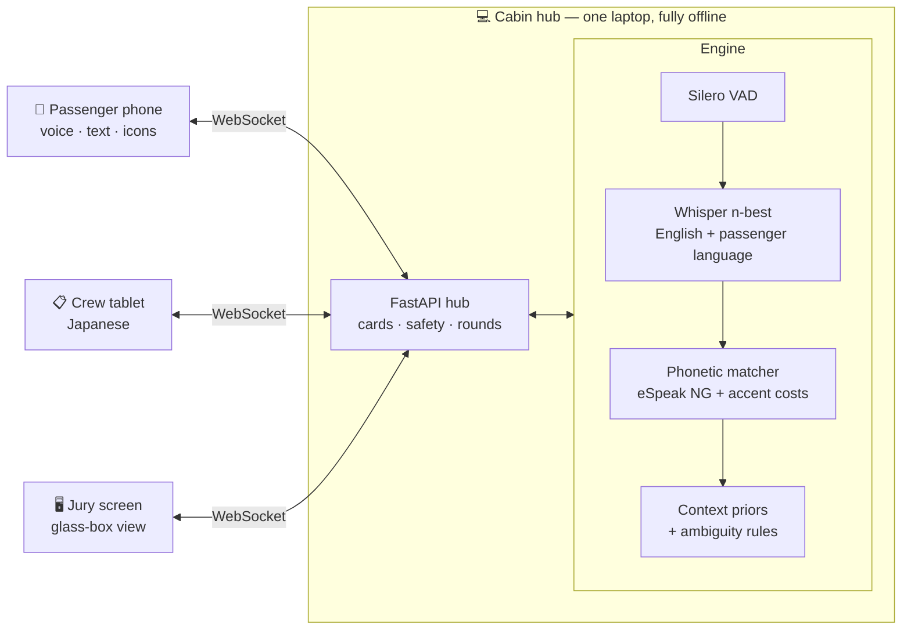

One request, end to end:

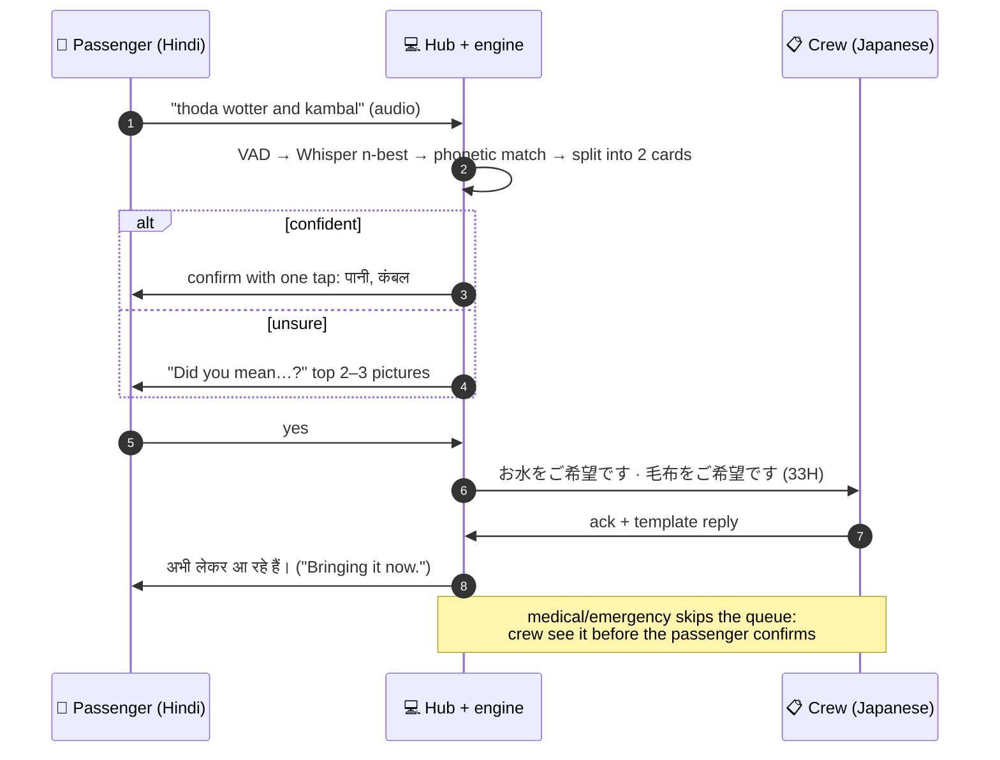

The matcher is the core idea. Speech-to-text often writes accented words the way they sound (*wotter*, *blankit*), and Hindi words
turn up in English sentences (*kambal*, blanket). Auralink turns both what was heard and every known request word into
phonemes, then compares them with a weighted edit distance in which common accent swaps are cheap
(v/w, retroflex t/d, a dropped final r and so on). Two thresholds decide what happens next:

- top score ≥ **t1** and well clear of the runner-up (gap ≥ **t2**): confirm with one tap
- close call: show the top 2–3 choices as pictures
- nothing plausible: open the icon grid

## Results

From [eval/results.md](eval/results.md), generated by `scripts/evaluate.py`. **Baseline A** is what most
systems do: take the first speech-to-text result, look for keywords, and never ask.

| System | First try | Within one tap | Wrong confident card | Urgent caught |
|---|---:|---:|---:|---:|
| Baseline A: first result, keywords | 56.1% | 56.1% | 0% | 76.9% |
| **Auralink, hybrid (default)** | **91.2%** | **93.0%** | **0%** | **100%** |

<sub>Text challenge set: 65 transcripts written to mimic accented and code-mixed speech-to-text output. The matcher was
developed on this set, so treat it as a benchmark, not a final result. On synthetic audio through Whisper `base`
(clean, 10 dB and 0 dB cabin noise) the hybrid matcher gets 92.9% first try against 64.3% for the baseline. Final
claims come from held-out volunteer recordings.</sub>

Speed on an Apple M1 CPU: about **0.7 s** for speech-to-text with Whisper `base`, **under 20 ms** for
matching, and **1.0–1.2 s** from the end of speech to the confirm screen (target: under 2 s).

## Features

- **A guided onboarding assistant**: a short, skippable tour from an illustrated crew avatar on a
  passenger's first visit, fully translated into 16 languages, not just the ones Auralink can speak aloud
  ([onboarding assistant](#onboarding-assistant))
- **One shared scanner for the whole cabin**: tap a seat on a map, say it out loud, or scan a boarding
  pass — no screen (and no printed QR code) needed at every seat ([shared scanner](#shared-cabin-scanner))
- **Voice, text or icons, in the passenger's language**: Whisper n-best plus a phonetic matcher, with a
  confirm step instead of guessing ([what is real](#what-is-real-and-what-is-a-placeholder))
- **Accent-aware matching** with hand-set and learned accent costs ([evaluation](#evaluation),
  [learned costs](#learned-accent-costs))
- **Accessibility as a first-class signal**: a passenger's accessibility profile follows them from
  check-in onto the crew's cabin map, shown in its own colour, distinct from a plain open request
  ([cabin-map colours](#cabin-map-accessibility-colours))
- **Safety briefing that checks understanding**: a live seat heat map of who understood, who wants it
  explained again, and an exit-row check
- **Check-in at the gate** for language and accessibility needs ([check-in](#check-in-the-airport-stage))
- **Medical triage**: an urgent medical request asks one follow-up question -- which symptom -- before
  it reaches the crew ([medical triage](#medical-triage))
- **Free Talk and Live Conversation**: open-vocabulary offline translation for anything outside the
  fixed, reviewed request list -- a one-shot suggestion, or a free-running two-way chat
  ([Free Talk and Live Conversation](#free-talk-and-live-conversation))
- **Crew phrasebook**: common phrases already translated into a passenger's language, one tap away
  on the crew tablet ([crew phrasebook](#crew-phrasebook))
- **Shake to call** and **turbulence detection**: shake the phone instead of finding a button; crew
  see several seats shaking at once as turbulence, not a flood of calls
  ([shake to call and turbulence detection](#shake-to-call-and-turbulence-detection))
- **Read aloud** with the phone's offline voice ([read aloud](#read-aloud))
- **Live PA captions** from pre-approved announcements, never machine translation ([PA captions](#live-pa-captions))
- **Care rounds**: one trolley loop for open requests and check-ins for quiet passengers ([care rounds](#care-rounds))
- **After landing**: gate, baggage and connecting-flight info, a seat-tied lost-item report that
  reaches the crew tablet live, and post-flight feedback, all in the passenger's own language
  ([after landing](#after-landing))
- **Flight report**: requests by outcome, type and language, recovery rate, safety comprehension,
  care rounds and post-flight feedback, since the last cabin reset, with a CSV download
  ([demo day](#demo-day))
- **Crash recovery**: cabin state survives a hub restart ([crash recovery](#crash-recovery))
- **Fails safe**: no hub, no network -- passenger phones fall back to a no-server pictogram card
  and crew can print an offline backup seat list ([fails safe](#fails-safe-no-hub-no-network))
- **Crew PIN**: crew, presenter, report and jury screens are locked on the shared cabin Wi-Fi ([crew PIN](#crew-pin))
- **New languages without code or retraining** ([adding a language](#adding-a-language-no-code-no-retraining)):
  16 languages of onboarding and request text today, with speech recognition and offline voice in
  English, Hindi, Tamil and Thai
- **Deployable as a live demo in minutes**: Docker, a free Render web service, a free Hugging Face
  Space, or a one-command tunnel from a laptop ([deploying a live demo](#deploying-a-live-demo))
- **Voice collection** for the held-out evaluation set ([collecting voices](#collecting-voices))

## Run it

```bash
uv venv .venv --python 3.12
uv pip install -p .venv/bin/python -r requirements-dev.txt
brew install espeak-ng          # phoneme matcher; apt install espeak-ng on Linux
scripts/run.sh
```

**Then open the Start page address the script prints (usually <http://localhost:8000/start>) on the same laptop.** The Start page explains everything in
plain words: how phones reach the laptop with no internet, how a passenger finds their seat, the crew PIN (shown
only on this laptop), and what every page is for. To try it alone, open **Passenger** and **Crew** side by
side, choose a language on the passenger screen, and type "thoda wotter and kambal".

| Who | Opens | How |
|---|---|---|
| Passenger | `/passenger` | One shared scanner for the whole cabin: tap a seat on the map, say it, or scan a boarding pass. A first-time seat also gets the onboarding assistant |
| Passenger (direct) | `/passenger?seat=34K` | A printable per-seat QR still works too (print them from `/seats`); picks a language the first time |
| Passenger, after landing | `/arrival?seat=34K` | Gate, baggage and connections; a lost-item report; post-flight feedback -- reachable from the passenger screen's header icon |
| Cabin crew | `/crew` | Tablet on the same Wi-Fi; enters the crew PIN once |
| Jury | `/judge` | Under the hood: how each request was understood (crew PIN) |

The current screens are a Next.js app (`web/`), built to `web/out/` and served by the hub at these same
paths (a `.html` suffix, e.g. `/passenger.html`, still works too). An older, plain HTML/JS set of screens
ships alongside it as a fallback: `AURALINK_UI=classic scripts/run.sh`.

Port 8000 busy (another app, for example another project's server)? `scripts/run.sh` and
`scripts/demo.sh` then pick the next free port by themselves (8001, 8002 ...) and print the exact address,
for example `Auralink: open http://localhost:8001/start.html`. Use that address: `localhost:8000` would
show the other app. Force a port with `PORT=8005 scripts/run.sh`.

**Settings:** `cp .env.example .env` and set `AURALINK_CREW_PIN` (6 digits). That is the only secret:
Auralink needs no passwords, accounts or API keys, because nothing goes to the cloud. Every other setting in
[.env.example](.env.example) is optional and explained there. `scripts/run.sh` and `scripts/demo.sh` read
`.env` automatically; it is git-ignored, so keep a copy if you delete the folder.

The first start downloads Whisper `base` (~145 MB) into the Hugging Face cache; after that
everything runs offline. Choose another model with `AURALINK_ASR_MODEL=small scripts/run.sh`.

### Demo day

Use `scripts/demo.sh` instead: it runs a pre-flight check (packages, Whisper downloaded,
eSpeak-NG, HTTPS certificate, free port, a test sentence), prints the address and a QR code for
phones, then starts the hub.

| Page | What it is for |
|---|---|
| `/presenter.html` | Pitch checklist with timer, health, backup buttons that send requests as a seat, and a two-tap cabin reset between rehearsals |
| `/seats.html` | Printable seat QR cards |
| `/noise.html` | Cabin-noise player with a level meter |
| `/report.html` | Flight report: requests by outcome, type and language, median time to acknowledge, recovery rate, urgent handling, safety comprehension per briefing step, exit-row results, PA captions sent and care rounds (requests delivered, check-in visits, walking saved), with a CSV download (`/api/report.csv`). It covers everything since the last cabin reset. |

Crew screens ask for the crew PIN (see [Crew PIN](#crew-pin)).

Before going on stage, with the hub running, run three checks in a second terminal:

```bash
.venv/bin/python scripts/rehearse.py --pin <crew PIN>    # the whole pitch story through the real sockets: 16 checks
.venv/bin/python scripts/pa_spoken_check.py              # 9 spoken announcements (Mac voices, or --dir your recordings)
.venv/bin/python scripts/export_translations.py          # review sheets for native speakers: docs/translation-review/
```

`rehearse.py` resets the cabin before and after, so never run it during the live demo.

### On phones

Run `scripts/setup_https.sh` once on the laptop (it asks before adding mkcert's local certificate
authority to the Mac's trusted list; undo with `mkcert -uninstall`), start the hub with
`scripts/demo.sh`, then open `https://<laptop-ip>:8000/phone-setup.html` on each phone. That page
walks through installing the certificate on iPhone or Android and has a live microphone test.

<details>
<summary><b>Manual steps</b></summary>

Phones only allow the microphone over HTTPS. Create a local certificate once:

```bash
brew install mkcert && mkcert -install
mkdir -p certs && mkcert -cert-file certs/hub.pem -key-file certs/hub-key.pem <laptop-ip> localhost
```

`scripts/run.sh` switches to HTTPS automatically when `certs/` exists. Install the mkcert root
certificate on each demo phone.

</details>

## Deploying a live demo

| Option | Use when | How |
|---|---|---|
| Docker (full) | A persistent server with a few GB RAM, e.g. an Oracle Cloud Always Free Ampere VM | `docker compose up -d` (`Dockerfile`, `docker-compose.yml`, `Caddyfile` — automatic HTTPS) |
| Render free web service | A free, no-card, always-on-ish link, trading away Free Talk's translation/voice | Connect the repo on Render as a **Blueprint** (`render.yaml` → `Dockerfile.render`, a trimmed build) -- live at [auralink-o11a.onrender.com](https://auralink-o11a.onrender.com/start) |
| Hugging Face Spaces | A free, no-card, full-featured link with more RAM than Render's free tier | Push to a Space's git remote (SDK: Docker — add a `title`/`emoji`/`sdk: docker`/`app_port: 8000` YAML front matter block to the top of this file first; Spaces reads it from there) |
| Cloudflare Quick Tunnel | Fastest: a public HTTPS link to a hub already running on your own laptop | `cloudflared tunnel --url http://localhost:8000` |

Render's free 512 MB tier can't hold Free Talk's translation/voice models, so `Dockerfile.render` drops
them (`requirements-render.txt`); everything else — onboarding, the shared scanner, requests, the crew
tablet — is unaffected, since `engine/translate.py` and `engine/tts.py` degrade gracefully without them.

### Testing and CI

```bash
.venv/bin/python -m pytest -q    # 172 tests (3 skip without Whisper: AURALINK_SKIP_WHISPER=1)
.venv/bin/ruff check .
```

[GitHub Actions](.github/workflows/tests.yml) runs both on every push and pull request. Voice tests that
need the Whisper model are skipped there (`AURALINK_SKIP_WHISPER=1`), so CI never downloads it.

## Project layout and owners

| Folder | Owner | What lives there |
|---|---|---|
| `engine/` | A | `interpret(nbest, context, lexicon) -> Result`. ASR in `asr.py`, matcher in `matcher.py` |
| `data/`, `eval/` | B | Intent lexicon, message templates, recording prompts and API (`hub/recordings.py`), evaluation |
| `hub/`, `hardware/` | C | FastAPI + WebSocket hub, card state machine, safety heat map, ESP32 panel |
| `web/` | D | Next.js + React screens (matte-black design), built to `web/out/` and served by the hub at the same URLs. See [web/README.md](web/README.md) |
| `apps/` | D | Original plain HTML/JS screens, kept as a fallback (`AURALINK_UI=classic scripts/run.sh`) |

## Feature guide

### Onboarding assistant

`/passenger` with no seat (or a first-ever visit to a seat) opens a short, skippable tour hosted by an
illustrated crew avatar: welcome, language, what Auralink can do, a demo request, a picture-only mode,
announcements, accessibility and a wrap-up. Text is fully translated into 16 languages
(`web/components/onboarding.jsx`); spoken narration uses the hub's offline voice where available and
falls back to the browser's own, with a note when it can't speak a language yet. Completion is
remembered per seat in `localStorage`, and a floating button replays it, asks for help, or changes
language/accessibility settings at any time.

### Shared cabin scanner

Not every seat has a screen, so `/passenger` with no `?seat=` shows one tap-your-seat cabin map instead
of needing a QR code at every seat. Three ways in: tap a seat, say its number (offline speech, same
matcher as every other request), or **Scan boarding pass** — every real boarding pass carries an
IATA BCBP barcode (`hub/bcbp.py`) with the seat on it, decoded entirely client-side. Per-seat QR codes
(`/seats`) still work as a direct alternative. `/boarding-pass` issues a test boarding pass for demos.

### Cabin-map accessibility colours

On the crew tablet's cabin map, a seat with an accessibility profile on file (from check-in or the
passenger's own settings) is shown in violet, distinct from a plain open request (amber) — urgent
(red) still wins if both apply. The colour key is shown above the map and on the Start page FAQ.

### Medical triage

When a request matches the `medical` intent, before it reaches the crew the passenger's phone asks
one follow-up question -- "What's wrong? Tap one." -- from a small picture list (chest pain,
breathing, fainting, allergic reaction, bleeding, other). Whatever they tap travels with the request
card, so the crew tablet shows not just "medical" but the symptom itself, in Japanese and English,
before anyone has walked to the seat. Medical and other urgent requests always skip the confirm step
and the care-round queue. Logic: `set_symptom`/`ask_symptom` in [hub/state.py](hub/state.py) and
[hub/main.py](hub/main.py); the question and symptom list are in `data/templates/messages.json`'s
`triage` section.

### Free Talk and Live Conversation

Two tiers of open-vocabulary translation sit alongside the fixed, reviewed request list -- both
explicitly tagged "machine-translated, not reviewed" and never used for safety briefings, exit-row
checks or PA captions:

- **Free Talk**: when nothing in the fixed list matches what a passenger said, the "I'm not fully
  sure" sheet offers a one-shot translation of what was heard, which the passenger can choose to
  send to crew as-is (`POST /api/freetalk/translate`).
- **Live Conversation**: the chat icon on both the passenger and crew screens opens a free-running,
  two-way, streaming-translated conversation for anything a request card doesn't cover -- each turn
  is transcribed, translated and spoken aloud in the other person's language in near real time
  (`hub/main.py` `handle_conv_audio`/`handle_conv_text`; UI in
  [web/components/liveconversation.jsx](web/components/liveconversation.jsx)).

Both run on an offline NLLB-200 (distilled, 600M parameters) through CTranslate2 at `int8`
([engine/translate.py](engine/translate.py)), the same pattern `engine/asr.py` uses for Whisper --
downloaded once (~2.4 GB), then fully offline. Needs `pip install transformers`; set
`AURALINK_FREE_TALK=0` to turn it off on a laptop that would rather keep the RAM for Whisper (Free
Talk is dropped entirely from the trimmed Render build, see
[deploying a live demo](#deploying-a-live-demo)).

### Crew phrasebook

A quick-reference panel on the crew tablet (open **Talk** on any seat) with everyday phrases --
greetings, directions, reassurance -- already translated into that passenger's language: for
anything a one-tap reply template doesn't cover and a full Live Conversation turn would be slower
for. Source: `data/templates/messages.json`'s `phrasebook` section, served at `/api/config` and
reloaded with the rest of the templates whenever the file changes.

### Shake to call and turbulence detection

A passenger can shake their phone instead of finding the **Call crew** button: three jolts within
about two seconds sends the same request as a tap, with a vibration and screen flash to confirm it
went through. If five or more *distinct seats* shake within a 12-second window
(`SHAKE_WINDOW_S`/`SHAKE_SEATS` in [hub/state.py](hub/state.py)), the crew tablet treats it as
**turbulence, not passengers calling** -- a banner offers to send the seatbelt safety briefing
straight away instead of letting five urgent-looking calls flood the request queue at once.

### Check-in (the airport stage)

`/checkin.html` is a kiosk page for the airport or boarding gate: the passenger picks language, seat
and any of large text, pictures only and read aloud, in their own language. A plain seat QR
(`passenger.html?seat=34K`) then opens with those settings, and the crew tablet's **Passenger needs**
panel lists who reads which language and who needs large text, pictures or read aloud. Only the seat
and preferences are stored (`data/flight/checkin.json`, git-ignored), never names; in a real
deployment this would come from the airline's check-in system.

### Read aloud

Passengers can switch on **Read aloud** (or open the seat link with `&read=1`): confirm questions,
crew replies, safety steps and exit-row questions are spoken by the phone's own offline voice in the
passenger's language, and a speaker button replays any of them. The crew tablet can announce new
requests in Japanese. Only the fixed, pre-approved sentences are spoken (`apps/speech.js`); online
voice services are never used, and it stays off in picture-only mode. If a device has no voice for a
language, the option is hidden.

### Live PA captions

On the crew tablet, **Live PA captions → Record announcement**, then make the announcement as usual
(Japanese or English, up to 30 s). Whisper decodes it in both languages, each reading is matched against
[data/templates/announcements.json](data/templates/announcements.json) by its key phrases, and the crew
see the match (with minutes or a gate number taken from the speech) before tapping **Send to all
seats**. Every seat shows a banner in its own language, with a screen flash and vibration for
passengers who cannot hear the PA. An announcement that is not in the library is not captioned and
the crew are told so: Auralink never machine-translates. Typed text works too (`POST /api/pa/match`
with `{"text": ...}`, then `POST /api/pa/send` with `{"id": "descent", "n": "20"}`).

While the crew are still recording, a caption preview takes shape live underneath the mic button
("Hearing: ... → Starting descent"), re-matching a growing snapshot of the same audio every second
or so on the quick passenger model (`POST /api/pa/match` with `{"fast": true}`). This is only a
preview, shown on the tablet, and is never what gets sent: the crew's own **Stop** always re-runs
the match on the accurate model, and nothing reaches a seat until they tap **Send to all seats**,
exactly as before.

Announcements use the larger Whisper `small` model (`AURALINK_PA_ASR_MODEL`, about 3–5 s), passenger
requests the fast `base` one. With `base`, spoken Japanese PAs came back with sound-alike spellings
(効果 for 降下, 伝統 for 点灯, 10分 for 二十分); `small` fixed the numbers, and those sound-alike spellings are
key phrases too, so the announcement is matched by how it sounds. `scripts/pa_spoken_check.py`: 9/9.

### Care rounds

The crew tablet always shows a planned **care round**: every open, non-urgent request for something
the crew carry (water, tea, blanket, pillow, food), as one loop from the front galley, down the left
aisle and back up the right, with a trolley load list and how much walking it saves compared with one
trip per request. Passengers who use large text or pictures only and have not asked for anything for
90 minutes (`AURALINK_CARE_AFTER_S`; `scripts/demo.sh` sets 2 minutes) are added as check-in stops,
because older and deaf passengers often do not ask. **Start round** tells each waiting passenger,
in their language, which stop they are ("stop 3 of 7"); **Done** at each seat closes its requests.
Urgent and medical requests never wait for a round. Logic: [hub/rounds.py](hub/rounds.py).

### After landing

`/arrival?seat=34K` -- one tap from the passenger screen's header icon once the seatbelt sign is
off -- gives every passenger three things in their own language:

- **Deplaning info**: gate, terminal and baggage-belt number, plus any connecting flight and its
  gate and boarding window (`GET /api/arrival`).
- **Lost & found**: a short description tied to the seat reaches the crew tablet's **Lost & found**
  tab live, where crew mark it Found or Returned (`POST /api/lost-item`, crew-only
  `GET /api/lost-items` and status updates).
- **Post-flight feedback**: an inconvenience / suggestion / compliment category, an optional
  1–5 star rating and a free-text message -- never tied to a name (`POST /api/feedback`).

Both lost items and feedback show up on the crew tablet the moment they are sent (no refresh needed)
and are rolled into the flight report's totals. State is cleared on a cabin reset and survives a hub
restart, the same as every other request. Logic: `LostItem`/`Feedback` in
[hub/state.py](hub/state.py); screen in
[web/app/arrival/page.jsx](web/app/arrival/page.jsx).

### Crash recovery

The hub saves the cabin state after every change (`data/flight/cabin_state.json`, git-ignored,
written atomically) and restores it on start: requests, briefing answers, exit-row checks and the
flight report survive a restart, and screens reconnect by themselves. The presenter console shows
when state was restored. Start clean with `AURALINK_FRESH=1 scripts/run.sh` or use Reset cabin.

### Fails safe: no hub, no network

Crash recovery above covers the hub coming back; this is for while it is down. Phones retry the
hub's socket every second (`web/lib/hub.js`), so a one-off drop never shows anything -- but once a
passenger's phone has failed to reconnect for about six seconds straight, it switches its own
screen into a no-server fallback: the type/speak bar (which needs the hub) is replaced by a plain
"No connection -- show this screen to a flight attendant" banner in the passenger's own language,
and the picture grid underneath keeps working exactly as before, since it was always rendered from
what had already loaded (local icons, strings already in memory) rather than fetched live. A tap
still queues over the socket and is delivered the moment it reconnects; the banner exists
for the case where it never does in time, so the passenger has something to hold up to a crew
member walking past. It clears itself the instant the phone reconnects.

The crew tablet gets the mirror image: the same six-second rule shows a "Hub connection lost"
banner telling crew to fall back to paper and walk the cabin, and the **Passenger needs** panel
has a **Print offline backup** button at any time (not just during an outage) that prints a plain
seat / language / accessibility table from whatever the tablet last knew -- crew who print it once
before departure always have a paper copy, even if the hub dies for the rest of the flight. Logic:
`OFFLINE_AFTER_MS`/`HUB_DOWN_AFTER_MS` in [web/app/passenger/page.jsx](web/app/passenger/page.jsx)
and [web/app/crew/page.jsx](web/app/crew/page.jsx); the print view is `OfflineRoster`, styled by
the `@media print` rule in [web/app/crew/crew.css](web/app/crew/crew.css).

### Crew PIN

Passengers and crew share the cabin Wi-Fi, so the crew side is locked with a PIN. `/crew.html`,
`/presenter.html`, `/report.html` and `/judge.html` (Under the hood quotes real seats' words) show
a small 乗務員PIN / Crew PIN prompt once per device; after that an HttpOnly cookie (derived from the
PIN, valid 24 h) unlocks `/ws/crew`, `/ws/judge`, `/api/status`, `/api/presenter/*`, `/api/pa/*`
and `/api/report*`. Without it HTTP answers 401 and sockets close with code 4401. Seat screens,
check-in, the recording page, the landing page and its "try it" box stay open. Set the PIN with
`AURALINK_CREW_PIN=482913 scripts/run.sh`; `scripts/demo.sh` prints it (and picks one if unset);
otherwise the hub makes a 6-digit PIN at startup and logs it once. Five wrong tries from one device
lock it out for a minute. Logic: [hub/auth.py](hub/auth.py). Not covered (a real aircraft would
need them): per-crew accounts, HTTPS-only cookies when serving plain HTTP, and the PIN rotating per flight.

### Adding a language (no code, no retraining)

1. `data/languages.json`: add `{"code": "bn", "name": "বাংলা", "asr": ["en", "bn"]}`, and the script's
   character range + eSpeak-NG voice under `scripts` if it has its own writing system.
2. `data/i18n/bn.json`: the passenger screen text (copy `en.json`, translate the values).
3. `data/lexicon/intents.json`: a `bn` label and spoken words for each of the 8 intents.
4. `data/templates/messages.json`: `bn` for crew replies, statuses, safety steps and the exit-row check.
5. Run `.venv/bin/python -m pytest -q tests/test_languages.py`: it lists anything still missing.

The hub reloads the word list as soon as it is saved. Tamil (`ta`) and Thai (`th`) were added this way.

Thai shows two general mechanisms, both switched on from `data/languages.json`:
- `"spaces": false`: Thai has no spaces between words, so text is split by longest match against the
  lexicon ("ขอน้ำหน่อยครับ" → "ขอ น้ำ หน่อย ครับ"; "ห้องน้ำ" stays toilet, not water).
- `"espeak": null`: eSpeak-NG's Thai phonemes are unusable, so Thai script is matched by spelling only.

Keep romanized words long and distinctive: short ones like "mon" (Thai pillow) collided with English
"son" and raised false alarms; `scripts/evaluate.py` catches this. All Hindi,
Tamil and Japanese text is a draft until a native speaker has checked it.

### Collecting voices

Open `/record.html` on a phone connected to the hub (HTTPS needed for the microphone on phones).
Volunteers consent, get a speaker code, and record 24 prompts in about 5 minutes. Clips land in
`data/recordings/`; see [data/recordings/README.md](data/recordings/README.md).

## What is real and what is a placeholder

- **Real:** n-best weighting, context priors, splitting one sentence into several requests,
  ambiguity rules (t1, t2, flat, empty), urgency override, card state machine, safety heat map.
- **Real:** voice. Silero VAD gate, Whisper encoder once, then English and Hindi decoding with
  5 hypotheses each (`engine/asr.py`). The Hindi pass is blocked from writing Urdu script, and
  repetitive output ("तो तो तो …") is dropped.
- **Real:** the Phonetic Intent Matcher (`engine/phonetic.py`). eSpeak-NG turns words into phonemes
  (Hindi voice for Devanagari, English for Latin script) and a weighted edit distance compares them
  using the accent cost matrix in `data/lexicon/phone_costs.json` (v/w, retroflex t/d, ch/च, dropped
  final r, r/l …). The default `hybrid` matcher averages this with spelling similarity; choose with
  `AURALINK_MATCHER=hybrid|phonetic|phonetic_uniform|text`. Without eSpeak-NG it falls back to spelling.
- **Experimental:** `AURALINK_MATCHER=trimodal` adds a third vote, a small multilingual sentence
  embedding model (`engine/semantic.py`, `pip install fastembed`, ~90 MB on first use, fully offline
  after that), aimed at paraphrases that share no sound or spelling with any lexicon word ("I haven't
  eaten since this morning" -> food). Measured on `data/eval/text_cases.json`, which has no
  paraphrase cases, it currently trades first-try accuracy for fewer false alarms (91.2% / 12.5% for
  `hybrid` vs 87.6% / 0% for `trimodal`) — a real cost on today's benchmark, not a proven win. Not the
  default until it is measured against a paraphrase-style held-out set.
- **Untuned:** `T1 = 0.70` and `T2 = 0.10` are starting values. Member B tunes them on the
  held-out split.

## For developers

<details>
<summary><b>Contracts (change only as a team)</b></summary>

- **Engine types** – `engine/types.py`: `Hypothesis`, `Context`, `Candidate`, `CardDraft`, `Result`.
- **Lexicon** – `data/lexicon/intents.json`. The hub reloads it when the file changes, so a new
  word or language works without a restart.
- **Templates** – `data/templates/messages.json`. Pre-approved text only; every Japanese and
  Hindi line needs a native-speaker check before the demo.
- **WebSocket messages** – see below.

</details>

<details>
<summary><b>WebSocket protocol</b></summary>

#### Passenger socket `/ws/passenger/{seat}`

| Sends | Receives |
|---|---|
| *binary frame*: one utterance, 16 kHz mono int16 PCM, max 10 s | `thinking` – speech received, working on it |
| `hello {lang, senior}` | `confirm {rule, cards[]}` – each card has `confident`, `options[]`, `urgent` |
| `text {text}` | `grid {reason, card_id?}` – show the icon grid |
| `icon {intent, card_id?}` | `status {card, message}` – message already in the passenger's language |
| `confirm {card_id, intent}` | `reply {card_id, text}` – crew reply, translated from a template |
| `reject {card_id}` | `safety {broadcast_id, template}` |
| `safety {understood}` | `notice {message}`, `error {detail}` |

#### Crew socket `/ws/crew`

Needs the crew PIN cookie (closes with 4401 without it; same for `/ws/judge`).
Sends `ack`, `reply {card_id, reply_id}`, `close`, `phase {phase}`, `broadcast {template_id}`.
Receives `state {phase, cards[], heatmap{seat: understood|explain_again|pending|idle|offline}, broadcast}`
after every change.

#### Judge socket `/ws/judge`

Receives `result {phase, result}` for every interpretation – the raw material for the glass-box view.

</details>

<details>
<summary><b>Request lifecycle</b></summary>

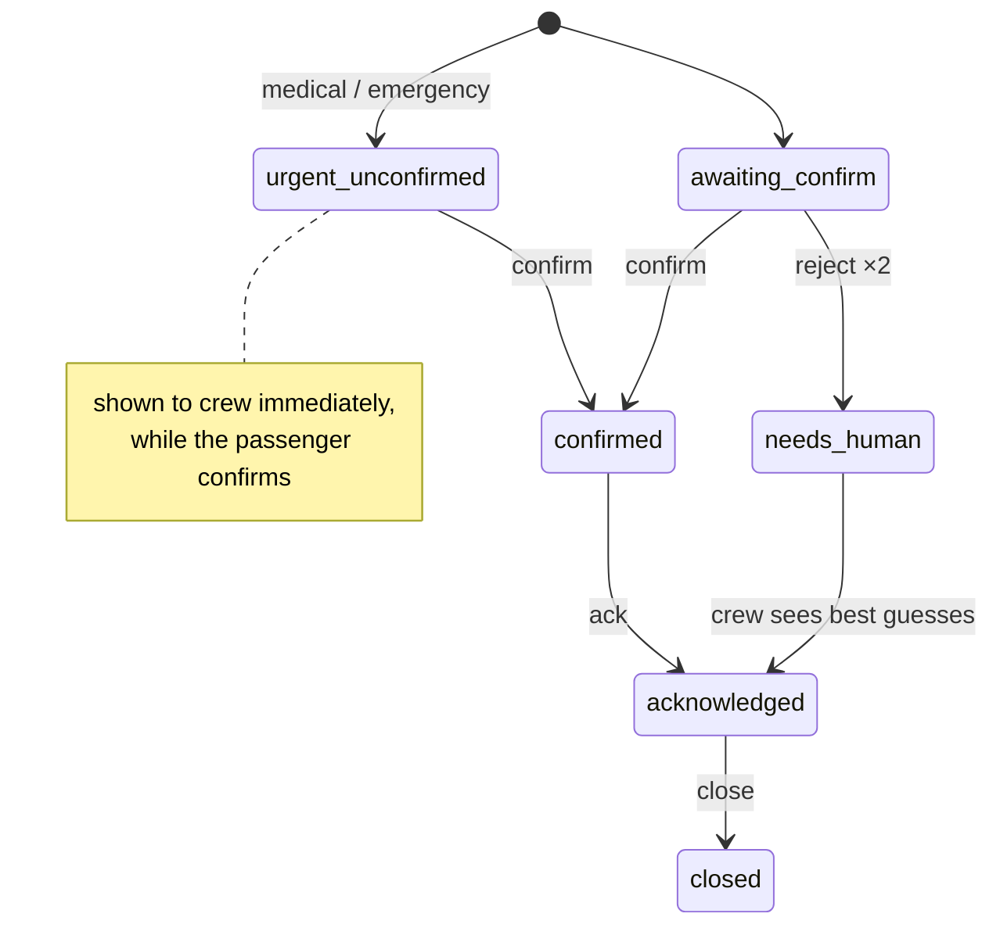

</details>

## Evaluation

```bash
.venv/bin/python scripts/evaluate.py --skip-audio   # text challenge set, seconds
.venv/bin/python scripts/evaluate.py                # + synthetic audio at clean / 10 / 0 dB
.venv/bin/python scripts/evaluate.py --real         # + volunteer recordings, test split
```

Writes [eval/results.md](eval/results.md), `eval/results.json` and `eval/results_chart.svg` (for the
deck). Compares Baseline A (first result, keywords, no confirmation) with four Auralink matchers.
The text challenge set was used to develop the matcher, so its numbers are optimistic; the claims
for the final presentation must come from the held-out volunteer recordings.

### Learned accent costs

```bash
.venv/bin/python scripts/learn_costs.py          # from the synthetic voices (run evaluate.py first)
.venv/bin/python scripts/learn_costs.py --real   # + volunteer read-aloud prompts, train split only
```

Compares what each speaker meant with what Whisper heard, sound by sound, and counts the swaps
(ɑ heard as ɔ, w as v ...). A swap seen at least 3 times becomes cheaper
(`cost = max(0.15, 1 − n/(n+3))`); one-off noise and sentences Whisper got completely wrong are
skipped. Writes `data/lexicon/phone_costs_learned.json` and [eval/learned_costs.md](eval/learned_costs.md);
`evaluate.py` then adds a "hybrid, learned costs" row. Honest status: the synthetic voices are too
few, so no swap has been seen often enough yet and the learned table equals the hand-set one. It
needs the volunteer recordings; only the train split is used, so the test split stays a fair exam.

### Speech-to-text spike (2026-10-21)

`scripts/asr_spike.py` → [eval/asr_spike_results.md](eval/asr_spike_results.md). Stand-in voices
(macOS Rishi, Aman, Lekha), 14 phrases, clean / 10 dB / 0 dB brown noise, Apple M1 CPU:

| Model | Intent accuracy (en+hi n-best) | Median ASR latency | Verdict |
|---|---|---|---|
| `base` | 88% | 0.67 s | default for the demo |
| `small` | 95% | 2.9 s | too slow on CPU |

Measured in the browser: end of speech → confirm screen in about 1.0–1.2 s (deck target < 2 s).
Silence and noise-only clips are rejected by the VAD gate. These are synthetic voices, so they are
a smoke test, not results; Member B's recordings replace them.

## License

[MIT](LICENSE) © 2026 The Auralink team. Screenshots in this README are real captures of the running app.
