<div align="center">
  

# Auralink

**Every passenger, understood.**

Repair-first communication between airline passengers and cabin crew, across accents, languages and a loud cabin.
When speech is unclear, Auralink **asks the passenger one simple question** instead of guessing.
A guided onboarding assistant welcomes every passenger in their own language, and one shared scanner replaces a
QR code per seat.

[](https://github.com/goyalnishtha841/auralink/actions/workflows/tests.yml)


### [▶ Try it live: auralink-o11a.onrender.com](https://auralink-o11a.onrender.com)
### [▶ Watch the 2-minute demo](https://drive.google.com/file/d/1mtJBbRh7b2T-ha4DbD3acO1qcfrpqsRB/view)

<br />

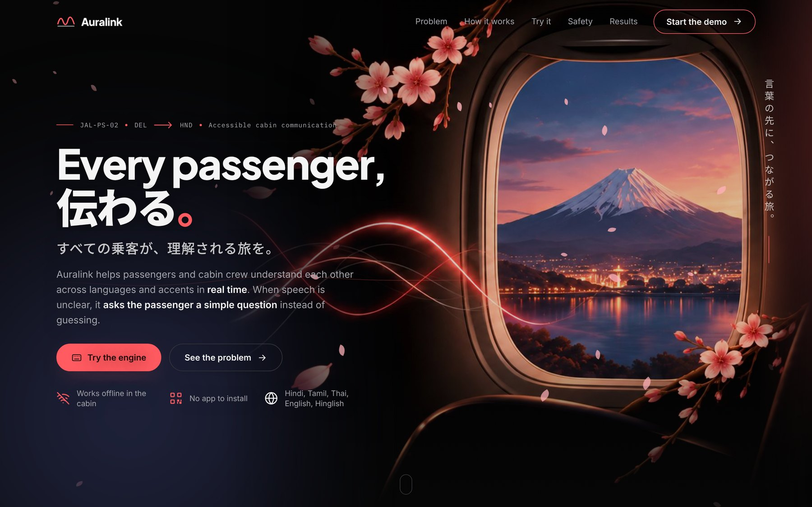

<sub>Built for **JAL-PS-02** at the **Thapar Japan Hackathon 2026** by team **Shinobi Systems**.</sub>

</div>

---

> **Reviewing this for judging? The 30-second version.**
>
> - **What it is:** repair-first communication between airline passengers and cabin crew — across accents,
>   languages and a loud cabin — without anything leaving the aircraft.
> - **What's hard about it:** turning noisy, accented, code-mixed speech into the right request, with no cloud
>   speech service, no machine translation for anything safety-critical, and no LLM in the loop.
> - **Engineering:** Whisper n-best + an accent-aware phonetic matcher, a FastAPI + WebSocket hub, a Next.js UI,
>   16 languages, a fail-safe offline mode and crash recovery — all running fully offline on one laptop.
> - **Proof:** deployed at [auralink-o11a.onrender.com](https://auralink-o11a.onrender.com), measured at 91.2%
>   first-try accuracy against a 56.1% keyword baseline, with a
>   [2-minute demo](https://drive.google.com/file/d/1mtJBbRh7b2T-ha4DbD3acO1qcfrpqsRB/view).

## Contents

[Demo](#take-a-look) · [The problem](#the-problem) · [What it does](#what-auralink-does) ·
[Features](#features) · [How it works](#how-it-works) · [Results](#results) ·
[Tech stack](#tech-stack-and-why) · [Safety and privacy](#safety-fairness-and-privacy) ·
[Run it locally](#run-it-locally) · [Deploying a live demo](#deploying-a-live-demo) ·
[Testing](#testing-and-ci) · [Repository layout](#repository-layout) ·
[Limitations and roadmap](#limitations-and-roadmap) · [Team](#team)

---

## Take a look

<table>
  <tr>
    <td width="25%" valign="top">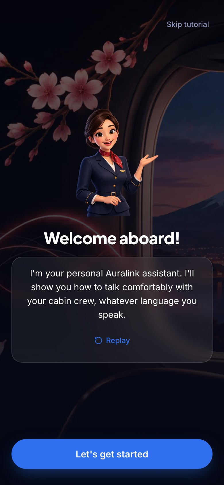<br /><sub><b>Onboarding assistant.</b> Every first-time passenger gets a short, skippable tour from an illustrated crew avatar, before anything else.</sub></td>
    <td width="25%" valign="top">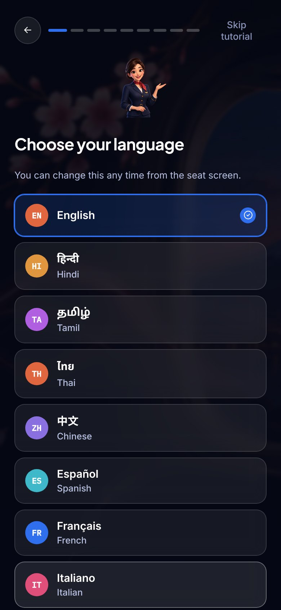<br /><sub><b>16 languages.</b> Every onboarding screen, request and crew reply is fully translated, not just the ones Auralink can speak aloud.</sub></td>
    <td width="25%" valign="top">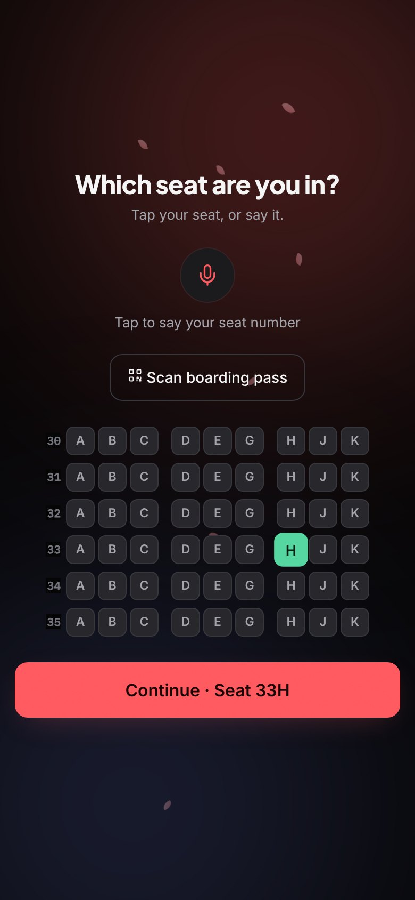<br /><sub><b>One shared scanner.</b> No screen at every seat? One QR code for the whole cabin: tap a seat, say it, or scan a boarding pass.</sub></td>
    <td width="25%" valign="top">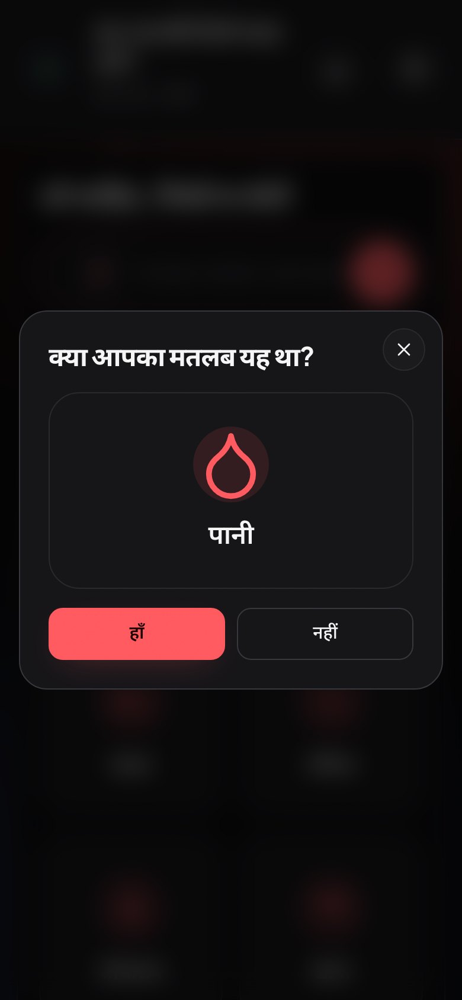<br /><sub><b>Passenger phone.</b> Asks instead of guessing, in the passenger's language, with pictures.</sub></td>
  </tr>
</table>

<table>
  <tr>
    <td width="62%" valign="top">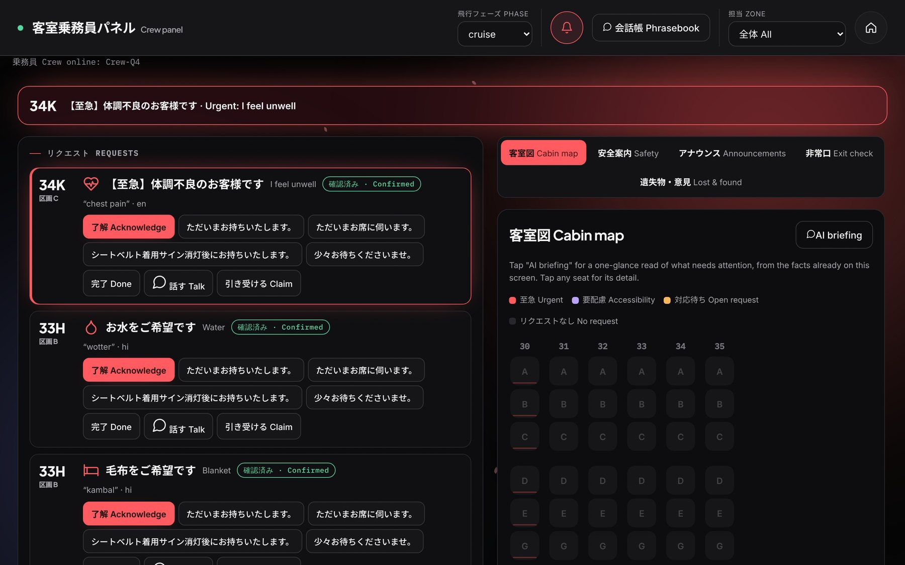<br /><sub><b>Crew tablet, in Japanese.</b> Urgent requests jump the queue before the passenger has even confirmed.</sub></td>
    <td width="38%" valign="top">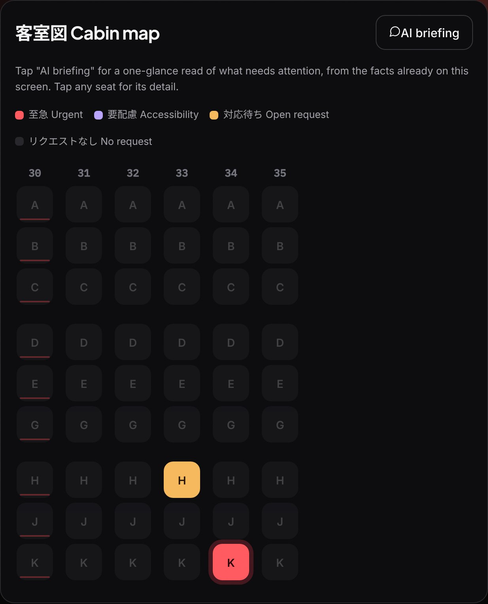<br /><sub><b>Cabin map, at a glance.</b> A seat with an accessibility profile on file is shown in violet, distinct from a plain open request.</sub></td>
  </tr>
  <tr>
    <td colspan="2">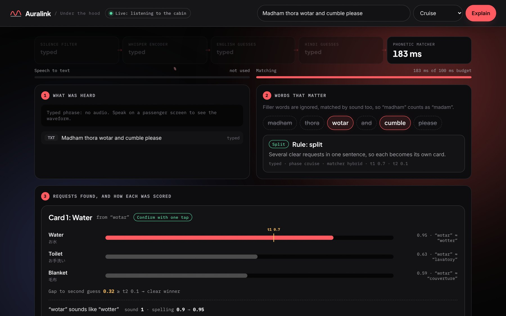<br /><sub><b>Under the hood (the jury screen).</b> Every decision in the open: which words mattered, which rule fired, and how each request was scored against the thresholds.</sub></td>
  </tr>
</table>

---

## The problem

Cabin crew and passengers often don't share a language, and speech-to-text mishears accented or code-mixed
speech (*"wotter"* for water, Hindi words inside an English sentence). Guessing gets requests wrong; asking
every time is slow. Auralink repairs understanding instead of guessing, entirely offline on one laptop — no
cloud speech service, no machine translation for anything safety-critical, and no LLM.

## What Auralink does

A passenger in seat 33H, flying Delhi → Tokyo, says *"Madam, thoda wotter and kambal please"*
(Hindi-English: "a little water and a blanket"). A Japanese crew member hears noise.

| | What happens |
|---|---|
| 🎙️ **Hear** | Whisper turns speech into several guesses in English **and** Hindi, all on the laptop. |
| 🧩 **Understand** | Filler words (*madam, thoda, please*) are dropped. *"wotter"* is matched to **water** by how it *sounds*, using an accent-aware phoneme distance, and *"kambal"* to **blanket**. One sentence becomes two requests. |
| ✅ **Check** | Unsure? The passenger's phone asks *"क्या आपका मतलब यह था? पानी"* ("Did you mean: water?") with a picture. One tap. |
| 📋 **Deliver** | The crew tablet shows **お水をご希望です · 33H** in Japanese. The crew taps a pre-approved reply, and the passenger reads it in Hindi. |

---

## Features

| | Feature | What it does |
|---|---|---|
| 🧑‍✈️ | **Onboarding assistant** | A short, skippable, fully-translated tour from an illustrated crew avatar on a passenger's first visit |
| 📷 | **One shared scanner** | Tap a seat, say it, or scan a boarding pass — no per-seat QR code needed |
| 🎙️ | **Voice, text or icons** | Whisper n-best plus a phonetic matcher, with a confirm step instead of guessing |
| 🗣️ | **Accent-aware matching** | Hand-set and learned accent costs turn "wotter" into water, "kambal" into blanket |
| ♿ | **Accessibility as a signal** | A passenger's accessibility profile follows them from check-in onto the crew's cabin map, shown in its own colour |
| 🛟 | **Safety briefing that checks understanding** | A live seat heat map of who understood, who wants it explained again, and an exit-row check |
| 🛎️ | **Check-in at the gate** | Language and accessibility needs captured before boarding |
| 🚑 | **Medical triage** | An urgent request asks one follow-up question — which symptom — before it reaches the crew |
| 💬 | **Free Talk & Live Conversation** | Offline, open-vocabulary translation for anything outside the fixed, reviewed request list |
| 📖 | **Crew phrasebook** | Common phrases, already translated into a passenger's language, one tap away on the crew tablet |
| 🔊 | **Read aloud** | Confirm questions, crew replies and safety steps spoken by the phone's offline voice |
| 📢 | **Live PA captions** | Crew record an announcement; it's matched to a reviewed template and sent as a caption — never machine-translated |
| 🧺 | **Care rounds** | One planned trolley loop for open requests, plus check-in stops for quiet passengers |
| 🛬 | **After landing** | Gate/baggage info, a seat-tied lost & found report, and post-flight feedback, all in the passenger's language |
| 📊 | **Flight report** | Requests by outcome, type and language, recovery rate, safety comprehension and care-round totals, with a CSV download |
| 🔍 | **Under the hood (jury screen)** | Every decision in the open — which words mattered, which rule fired, how each request scored against the thresholds |
| 💾 | **Crash recovery** | Cabin state survives a hub restart |
| 🔌 | **Fails safe** | No hub, no network — phones fall back to an offline pictogram card, and crew can print a paper backup |
| 🔐 | **Crew PIN** | Crew, presenter, report and jury screens are locked on the shared cabin Wi-Fi |
| 📱 | **One QR, either role** | A single demo QR code (`/demo`, `/go`) lets the scanner pick passenger or crew — handy for live demos |
| 🎙️ | **Voice collection** | Volunteers record prompts on a phone (`/record`) for the held-out evaluation set |
| 🌍 | **New languages, no code or retraining** | 16 languages of onboarding and request text today |
| 🚀 | **Deployable in minutes** | Docker, a free Render web service, a free Hugging Face Space, or a one-command tunnel from a laptop |

---

## How it works

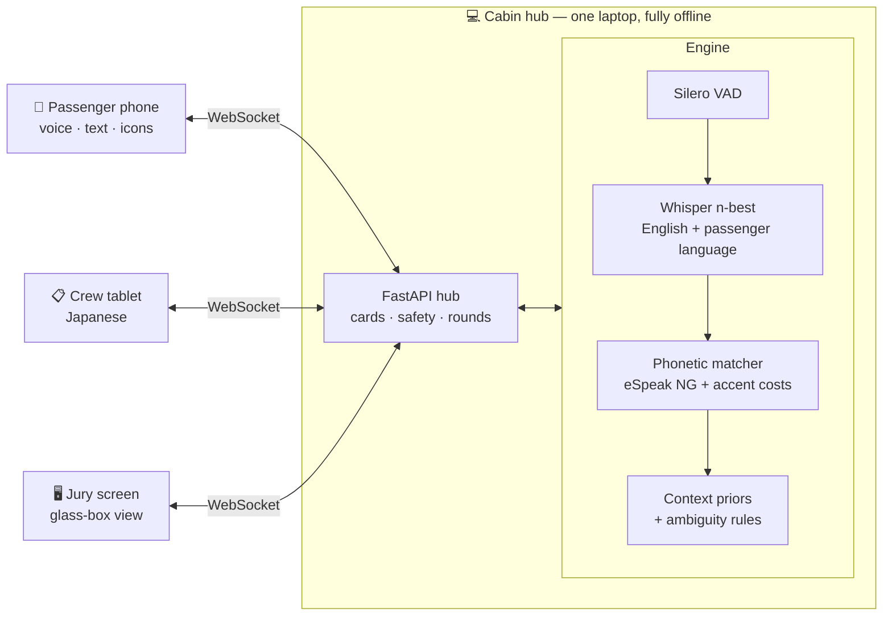

One request, end to end:

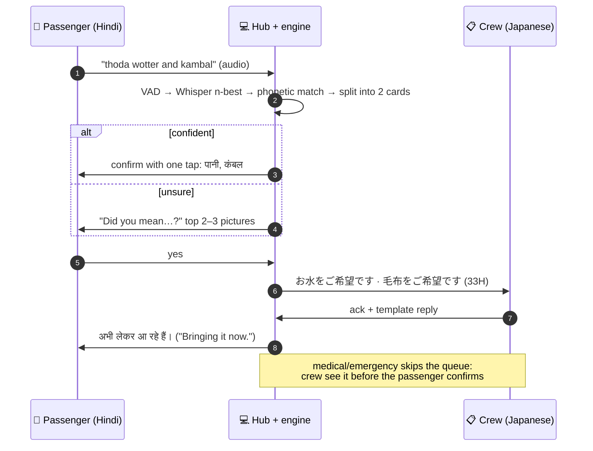

The matcher is the core idea. Speech-to-text often writes accented words the way they sound (*wotter*, *blankit*), and Hindi words
turn up in English sentences (*kambal*, blanket). Auralink turns both what was heard and every known request word into
phonemes, then compares them with a weighted edit distance in which common accent swaps are cheap
(v/w, retroflex t/d, a dropped final r and so on). Two thresholds decide what happens next:

- top score ≥ **t1** and well clear of the runner-up (gap ≥ **t2**): confirm with one tap
- close call: show the top 2–3 choices as pictures
- nothing plausible: open the icon grid

---

## Results

From [eval/results.md](eval/results.md), generated by `scripts/evaluate.py`. **Baseline A** is what most
systems do: take the first speech-to-text result, look for keywords, and never ask.

| System | First try | Within one tap | Wrong confident card | Urgent caught |
|---|---:|---:|---:|---:|
| Baseline A: first result, keywords | 56.1% | 56.1% | 0% | 76.9% |
| **Auralink, hybrid (default)** | **91.2%** | **93.0%** | **0%** | **100%** |

<sub>Text challenge set: 65 transcripts written to mimic accented and code-mixed speech-to-text output. The matcher was
developed on this set, so treat it as a benchmark, not a final result. On synthetic audio through Whisper `base`
(clean, 10 dB and 0 dB cabin noise) the hybrid matcher gets 92.9% first try against 64.3% for the baseline. Final
claims come from held-out volunteer recordings.</sub>

Speed on an Apple M1 CPU: about **0.7 s** for speech-to-text with Whisper `base`, **under 20 ms** for
matching, and **1.0–1.2 s** from the end of speech to the confirm screen (target: under 2 s).

---

## Tech stack and why

| Layer | Choice | Why this one |
|---|---|---|
| Speech | Whisper `base`, n-best hypotheses | Runs fully on-device; n-best keeps alternate accented readings instead of committing to one |
| Matching | eSpeak-NG phonemes + weighted edit distance | Compares by how words *sound*, not just spelling, with accent-specific costs |
| Translation (Free Talk) | Offline NLLB-200 (distilled, 600M) via CTranslate2 at `int8` | Open-vocabulary translation stays fully offline; dropped from the trimmed Render build |
| Backend | FastAPI + WebSockets | One hub serves passenger, crew and jury screens with live updates, no polling |
| Frontend | Next.js + React | Built to static output (`web/out/`) and served by the same hub — one URL, no CORS |
| State | JSON on disk, written atomically | Cabin state (requests, briefings, reports) survives a hub restart |
| Deploy | Docker / Render / Hugging Face Spaces / Cloudflare tunnel | A persistent server, a free always-on-ish link, or a one-command tunnel from a laptop |
| Quality | pytest, ruff, GitHub Actions | 173 tests, offline evals, CI on every push |

---

## Safety, fairness and privacy

- **Nothing leaves the aircraft.** No cloud speech service, no machine translation for safety briefings,
  exit-row checks or PA captions — only reviewed templates.
- **Fails safe.** No hub, no network — phones fall back to an offline pictogram card, and crew can print a
  paper backup roster at any time.
- **Fair by design.** Never grades accent or fluency; typing works everywhere voice doesn't; a confirm step
  stands between a guess and a request being sent.
- **Privacy.** Only a seat and stated preferences are stored, never names; check-in data stays local and
  git-ignored; crew, presenter, report and jury screens are PIN-locked on the shared cabin Wi-Fi.

---

## Run it locally

```bash
uv venv .venv --python 3.12
uv pip install -p .venv/bin/python -r requirements-dev.txt
brew install espeak-ng          # phoneme matcher; apt install espeak-ng on Linux
scripts/run.sh
```

**Then open the Start page address the script prints (usually <http://localhost:8000/start>) on the same laptop.** The Start page explains everything in
plain words: how phones reach the laptop with no internet, how a passenger finds their seat, the crew PIN (shown
only on this laptop), and what every page is for. To try it alone, open **Passenger** and **Crew** side by
side, choose a language on the passenger screen, and type "thoda wotter and kambal".

| Who | Opens | How |
|---|---|---|
| Passenger | `/passenger` | One shared scanner for the whole cabin: tap a seat on the map, say it, or scan a boarding pass. A first-time seat also gets the onboarding assistant |
| Passenger (direct) | `/passenger?seat=34K` | A printable per-seat QR still works too (print them from `/seats`); picks a language the first time |
| Passenger, after landing | `/arrival?seat=34K` | Gate, baggage and connections; a lost-item report; post-flight feedback — reachable from the passenger screen's header icon |
| Cabin crew | `/crew` | Tablet on the same Wi-Fi; enters the crew PIN once |
| Jury | `/judge` | Under the hood: how each request was understood (crew PIN) |

**Settings:** `cp .env.example .env` and set `AURALINK_CREW_PIN` (6 digits). That is the only secret:
Auralink needs no passwords, accounts or API keys, because nothing goes to the cloud. Every other setting in
[.env.example](.env.example) is optional and explained there.

The first start downloads Whisper `base` (~145 MB) into the Hugging Face cache; after that
everything runs offline. Choose another model with `AURALINK_ASR_MODEL=small scripts/run.sh`.

Port 8000 busy? `scripts/run.sh` and `scripts/demo.sh` pick the next free port by themselves (8001, 8002 ...)
and print the exact address. Force one with `PORT=8005 scripts/run.sh`.

<details>
<summary><b>On phones</b></summary>

Run `scripts/setup_https.sh` once on the laptop (it asks before adding mkcert's local certificate
authority to the Mac's trusted list; undo with `mkcert -uninstall`), start the hub with
`scripts/demo.sh`, then open `https://<laptop-ip>:8000/phone-setup.html` on each phone. That page
walks through installing the certificate on iPhone or Android and has a live microphone test.

Manual steps: phones only allow the microphone over HTTPS.

```bash
brew install mkcert && mkcert -install
mkdir -p certs && mkcert -cert-file certs/hub.pem -key-file certs/hub-key.pem <laptop-ip> localhost
```

`scripts/run.sh` switches to HTTPS automatically when `certs/` exists. Install the mkcert root
certificate on each demo phone.

</details>

<details>
<summary><b>Demo day</b></summary>

Use `scripts/demo.sh` instead: it runs a pre-flight check (packages, Whisper downloaded,
eSpeak-NG, HTTPS certificate, free port, a test sentence), prints the address and a QR code for
phones, then starts the hub.

| Page | What it is for |
|---|---|
| `/presenter.html` | Pitch checklist with timer, health, backup buttons that send requests as a seat, and a two-tap cabin reset between rehearsals |
| `/seats.html` | Printable seat QR cards |
| `/noise.html` | Cabin-noise player with a level meter |
| `/report.html` | Flight report: requests by outcome, type and language, median time to acknowledge, recovery rate, urgent handling, safety comprehension, exit-row results, PA captions sent and care-round totals, with a CSV download (`/api/report.csv`) |

Before going on stage, with the hub running, run three checks in a second terminal:

```bash
.venv/bin/python scripts/rehearse.py --pin <crew PIN>    # the whole pitch story through the real sockets: 16 checks
.venv/bin/python scripts/pa_spoken_check.py              # 9 spoken announcements (Mac voices, or --dir your recordings)
.venv/bin/python scripts/export_translations.py          # review sheets for native speakers: docs/translation-review/
```

`rehearse.py` resets the cabin before and after, so never run it during the live demo.

</details>

---

## Deploying a live demo

| Option | Use when | How |
|---|---|---|
| Docker (full) | A persistent server with a few GB RAM, e.g. an Oracle Cloud Always Free Ampere VM | `docker compose up -d` (`Dockerfile`, `docker-compose.yml`, `Caddyfile` — automatic HTTPS) |
| Render free web service | A free, no-card, always-on-ish link, trading away Free Talk's translation/voice | Connect the repo on Render as a **Blueprint** (`render.yaml` → `Dockerfile.render`) — live at [auralink-o11a.onrender.com](https://auralink-o11a.onrender.com) |
| Hugging Face Spaces | A free, no-card, full-featured link with more RAM than Render's free tier | Push to a Space's git remote (SDK: Docker — add a `title`/`emoji`/`sdk: docker`/`app_port: 8000` YAML front-matter block to the top of this file first; Spaces reads it from there) |
| Cloudflare Quick Tunnel | Fastest: a public HTTPS link to a hub already running on your own laptop | `cloudflared tunnel --url http://localhost:8000` |

Render's free 512 MB tier can't hold Free Talk's translation/voice models, so `Dockerfile.render` drops
them (`requirements-render.txt`); everything else — onboarding, the shared scanner, requests, the crew
tablet — is unaffected, since `engine/translate.py` and `engine/tts.py` degrade gracefully without them.

---

## Testing and CI

```bash
.venv/bin/python -m pytest -q    # 173 tests (3 skip without Whisper: AURALINK_SKIP_WHISPER=1)
.venv/bin/ruff check .
```

[GitHub Actions](.github/workflows/tests.yml) runs both on every push and pull request. Voice tests that
need the Whisper model are skipped there (`AURALINK_SKIP_WHISPER=1`), so CI never downloads it.

---

## Repository layout

```
auralink/
├── engine/        # interpret(nbest, context, lexicon) -> Result; ASR in asr.py, matcher in matcher.py
├── data/, eval/    # Intent lexicon, message templates, recording prompts and API, evaluation
├── hub/, hardware/ # FastAPI + WebSocket hub, card state machine, safety heat map, ESP32 panel
├── web/           # Next.js + React screens, built to web/out/ and served by the hub. See web/README.md
├── apps/          # Original plain HTML/JS screens, kept as a fallback (AURALINK_UI=classic scripts/run.sh)
└── scripts/       # run.sh, demo.sh, evaluate.py, learn_costs.py, rehearse.py, live checks
```

<details>
<summary><b>For developers: contracts, WebSocket protocol, request lifecycle</b></summary>

**Contracts (change only as a team):**

- **Engine types** – `engine/types.py`: `Hypothesis`, `Context`, `Candidate`, `CardDraft`, `Result`.
- **Lexicon** – `data/lexicon/intents.json`. The hub reloads it when the file changes, so a new
  word or language works without a restart.
- **Templates** – `data/templates/messages.json`. Pre-approved text only; every Japanese and
  Hindi line needs a native-speaker check before the demo.

**WebSocket protocol:**

Passenger socket `/ws/passenger/{seat}` — sends a binary audio frame, `hello {lang, senior}`, `text {text}`,
`icon {intent, card_id?}`, `confirm {card_id, intent}`, `reject {card_id}`, `safety {understood}`; receives
`thinking`, `confirm {rule, cards[]}`, `grid {reason, card_id?}`, `status {card, message}`, `reply {card_id, text}`,
`safety {broadcast_id, template}`, `notice`/`error`.

Crew socket `/ws/crew` — needs the crew PIN cookie (closes with 4401 without it; same for `/ws/judge`). Sends
`ack`, `reply {card_id, reply_id}`, `close`, `phase {phase}`, `broadcast {template_id}`. Receives
`state {phase, cards[], heatmap, broadcast}` after every change.

Judge socket `/ws/judge` — receives `result {phase, result}` for every interpretation, the raw material for
the glass-box view.

**Request lifecycle:**

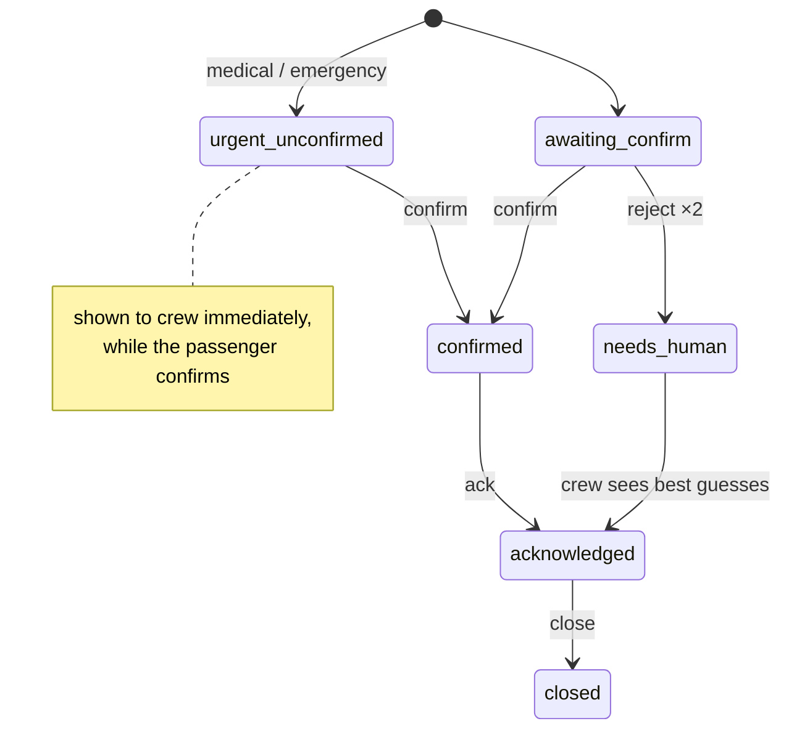

**Evaluation:**

```bash
.venv/bin/python scripts/evaluate.py --skip-audio   # text challenge set, seconds
.venv/bin/python scripts/evaluate.py                # + synthetic audio at clean / 10 / 0 dB
.venv/bin/python scripts/evaluate.py --real         # + volunteer recordings, test split
.venv/bin/python scripts/learn_costs.py             # learned accent costs from synthetic voices
```

Writes [eval/results.md](eval/results.md), `eval/results.json` and `eval/results_chart.svg`, comparing
Baseline A against four Auralink matchers. Learned costs: compares what each speaker meant with what Whisper
heard, sound by sound, and counts the swaps (ɑ heard as ɔ, w as v ...); a swap seen at least 3 times becomes
cheaper. Writes `data/lexicon/phone_costs_learned.json` and [eval/learned_costs.md](eval/learned_costs.md).

**Collecting voices:** open `/record.html` on a phone connected to the hub (HTTPS needed for the microphone).
Volunteers consent, get a speaker code, and record 24 prompts in about 5 minutes; clips land in
`data/recordings/` (see [data/recordings/README.md](data/recordings/README.md)) and feed `learn_costs.py --real`
and `evaluate.py --real` above.

**Adding a language (no code, no retraining):**

1. `data/languages.json`: add the code, name, ASR languages, and a script's character range + eSpeak-NG voice.
2. `data/i18n/<code>.json`: the passenger screen text (copy `en.json`, translate the values).
3. `data/lexicon/intents.json`: a label and spoken words for each intent in that language.
4. `data/templates/messages.json`: crew replies, statuses, safety steps and the exit-row check.
5. Run `.venv/bin/python -m pytest -q tests/test_languages.py`: it lists anything still missing.

The hub reloads the word list as soon as it is saved. Tamil (`ta`) and Thai (`th`) were added this way.

</details>

---

## Limitations and roadmap

We'd rather state these than have you find them:

- **Matcher thresholds (T1 = 0.70, T2 = 0.10) are starting values**, not yet tuned against a large held-out set.
- **Benchmarks are optimistic:** the text challenge set was used to develop the matcher; final claims need
  the held-out volunteer recordings.
- **Render's free tier drops Free Talk and Live Conversation** (translation + voice) to fit 512 MB RAM;
  everything else is unaffected.
- **Trimodal semantic matching is experimental:** it currently trades first-try accuracy for fewer false
  alarms (91.2% / 12.5% for hybrid vs 87.6% / 0% for trimodal) — not the default until measured against a
  paraphrase-style held-out set.
- **Hindi, Tamil and Japanese text is a draft** until a native speaker has checked it.

**Next:** calibrate learned accent costs on more volunteer recordings · tune T1/T2 on held-out data · a
paraphrase-style benchmark for the semantic matcher · more languages.

---

## Team

Built for **JAL-PS-02** at the **Thapar Japan Hackathon 2026** by **Team Shinobi Systems**.

| Member | Area |
|---|---|
| **Nishtha Goyal** ([@goyalnishtha841](https://github.com/goyalnishtha841)) | Speech engine and accent-aware matcher, the hub, crew tablet and PIN, live PA captions, care rounds, medical triage, check-in, crew phrasebook, flight report, presenter console, crash recovery, 16 languages, evaluation and CI |
| **Vikas Verma** ([@Vikasverma9515](https://github.com/Vikasverma9515)) | Next.js UI, the onboarding assistant, the shared seat scanner (tap, say or scan a boarding pass), Live Conversation with translated speech, and the Render deploy |
| **Asmita Roy** ([@techAsmita](https://github.com/techAsmita)) | Landing page and visual design, responsive passenger and crew screens, Start page, favicon, crew navbar, fail-safe mode (offline pictograms, printable crew backup), live PA caption feedback, phone layout fixes |

**License:** [MIT](LICENSE) © 2026 Team Shinobi Systems (Nishtha Goyal, Vikas Verma, Asmita Roy). Screenshots in this README are real captures of the running app.
